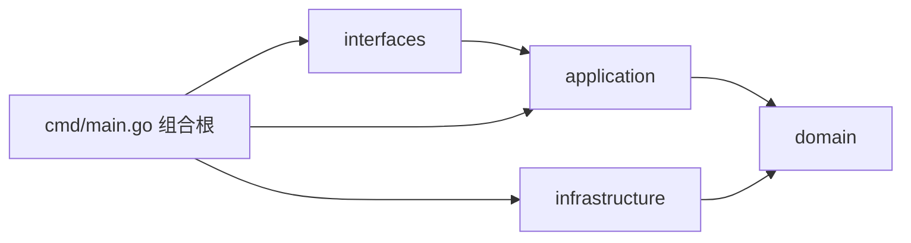

# 01 - DDD 架构改造

## 1. 改造背景

改造前，后端按业务模块平铺：

```text
internal/
├── account/
│   ├── entity.go
│   ├── handler.go
│   ├── repo.go
│   └── service.go
├── video/
├── social/
└── feed/
```

这种方式上手快，但存在几个问题：

- Handler、Service、Repository 混在同一个包，边界不清晰。
- 领域实体直接带 GORM 标签，业务规则和数据库细节耦合。
- Service 直接依赖 GORM、Redis、RabbitMQ，难以单元测试。
- 面试时很难讲清“领域层到底负责什么”。

改造目标：

1. 按限界上下文组织代码。
2. 领域层只保留业务规则和接口。
3. 应用层负责用例编排。
4. 基础设施层实现数据库、缓存、JWT 等细节。
5. 接口层只处理 HTTP 协议。

---

## 2. 目标分层

```text
backend/internal/
├── domain/                 # 领域层：实体、值对象、领域错误、仓储接口
│   └── account/
├── application/            # 应用层：用例编排
│   └── account/
├── infrastructure/         # 基础设施层：MySQL、Redis、JWT、bcrypt
│   ├── persistence/mysql/
│   └── security/
└── interfaces/             # 接口层：HTTP、WebSocket、DTO
    └── http/account/
```

依赖方向：



规则：

- `domain` 只能依赖标准库和领域内部包。
- `application` 可以依赖 `domain`，不能依赖 `infrastructure` 和 `interfaces`。
- `infrastructure` 实现 `domain` 定义的接口。
- `interfaces` 依赖 `application`，不直接操作数据库。
- `cmd/main.go` 是唯一组合根，负责创建具体实现并注入。

---

## 3. 账号上下文落地

### 3.1 领域层

`domain/account` 只定义“账号是什么”和“账号能做什么”。

```go
// 账号聚合根
type Account struct {
    ID           uint
    Username     string
    PasswordHash string
}

// 用户名清洗与校验
func NormalizeUsername(username string) (string, error) {
    username = strings.TrimSpace(username)
    if username == "" {
        return "", ErrUsernameRequired
    }
    return username, nil
}

// 改名行为
func (a *Account) Rename(newUsername string) error {
    if a == nil {
        return ErrAccountNotFound
    }
    normalized, err := NormalizeUsername(newUsername)
    if err != nil {
        return err
    }
    a.Username = normalized
    return nil
}
```

仓储接口也定义在领域层：

```go
type Repository interface {
    Create(ctx context.Context, account *Account) error
    FindByID(ctx context.Context, id uint) (*Account, error)
    FindByUsername(ctx context.Context, username string) (*Account, error)
    UpdateUsername(ctx context.Context, id uint, username string) error
    UpdatePassword(ctx context.Context, id uint, passwordHash string) error
}
```

刷新令牌属于认证领域，因此也定义在 `domain/account`：

```go
type RefreshToken struct {
    ID        uint
    AccountID uint
    JTI       string
    FamilyID  string
    ExpiresAt time.Time
    RevokedAt *time.Time
    CreatedAt time.Time
}
```

### 3.2 应用层

`application/account.Service` 不关心 Token 如何签名、密码如何哈希、数据库是哪张表，只负责编排用例。

```go
type Service struct {
    accounts      domainaccount.Repository
    refreshTokens domainaccount.RefreshTokenRepository
    tokens        domainaccount.TokenService
    hasher        domainaccount.PasswordHasher
    now           func() time.Time
}
```

登录用例：

```go
func (s *Service) Login(ctx context.Context, username, password string) (*domainaccount.TokenPair, error) {
    account, err := s.accounts.FindByUsername(ctx, username)
    if err != nil {
        return nil, domainaccount.ErrInvalidCredentials
    }
    if err := s.hasher.Compare(account.PasswordHash, password); err != nil {
        return nil, domainaccount.ErrInvalidCredentials
    }

    pair, err := s.tokens.Issue(account.ID, account.Username, "")
    if err != nil {
        return nil, err
    }
    if err := s.saveRefreshToken(ctx, account.ID, pair); err != nil {
        return nil, err
    }
    return pair, nil
}
```

注意这里没有出现 `bcrypt`、`jwt`、`gorm`，这些都属于基础设施细节。

### 3.3 基础设施层

MySQL 仓储负责把领域实体转换为 GORM 模型：

```go
type AccountRepository struct {
    db *gorm.DB
}

func (r *AccountRepository) FindByUsername(ctx context.Context, username string) (*domainaccount.Account, error) {
    var model AccountModel
    if err := r.db.WithContext(ctx).Where("username = ?", username).First(&model).Error; err != nil {
        if errors.Is(err, gorm.ErrRecordNotFound) {
            return nil, domainaccount.ErrAccountNotFound
        }
        return nil, err
    }
    return model.toDomain(), nil
}
```

JWT 实现放在 `infrastructure/security`：

```go
func (s *JWTService) Issue(accountID uint, username string, familyID string) (*domainaccount.TokenPair, error) {
    now := s.now()
    if familyID == "" {
        familyID = newRandomID()
    }
    accessJTI := newRandomID()
    refreshJTI := newRandomID()
    // 分别签发 access / refresh
}
```

### 3.4 接口层

HTTP Handler 只做：

1. 绑定 JSON。
2. 调用应用服务。
3. 把领域错误映射为 HTTP 状态码。
4. 组装响应。

```go
func (h *Handler) Login(c *gin.Context) {
    var req loginRequest
    if err := c.ShouldBindJSON(&req); err != nil {
        writeError(c, err)
        return
    }
    pair, err := h.service.Login(c.Request.Context(), req.Username, req.Password)
    if err != nil {
        writeError(c, err)
        return
    }
    c.JSON(http.StatusOK, newTokenResponse(pair))
}
```

错误映射：

```go
case errors.Is(err, domainaccount.ErrInvalidCredentials):
    status = http.StatusUnauthorized
case errors.Is(err, domainaccount.ErrUsernameTaken):
    status = http.StatusConflict
case errors.Is(err, domainaccount.ErrTokenRevoked):
    status = http.StatusUnauthorized
```

### 3.5 组合根

`cmd/main.go` 负责把所有具体实现装配起来：

```go
tokens, err := security.NewJWTServiceFromEnv()
if err != nil {
    log.Fatalf("Failed to initialize JWT service: %v", err)
}
accountRepository := accountmysql.NewAccountRepository(sqlDB)
refreshTokenRepository := accountmysql.NewRefreshTokenRepository(sqlDB)
accountApp := appaccount.NewService(
    accountRepository,
    refreshTokenRepository,
    tokens,
    security.NewBcryptHasher(),
)
r := apphttp.SetRouter(sqlDB, cache, rmq, accountApp, tokens)
```

这样依赖关系全部在启动时确定，业务代码里不需要 `init()` 或全局变量。

---

## 4. 渐进式迁移策略

没有一次性搬迁所有模块，原因是：

- `video`、`social`、`feed` 之间仍有耦合。
- 全量重写容易引入回归。
- 面试项目更需要“可运行 + 可讲清”，而不是目录好看。

采用 Strangler 模式：

1. 先把账号模块完整迁移到 DDD。
2. 新功能必须按 DDD 分层开发。
3. 旧模块保持可运行，后续按上下文逐个迁移。
4. 每迁移一个模块，切换路由、补测试、删除旧代码。

当前状态：

| 模块 | 状态 |
|---|---|
| account/auth | 已完成 DDD 迁移 |
| video | 保留原有结构，后续迁移 |
| social | 保留原有结构，后续迁移 |
| feed | 保留原有结构，后续迁移 |
| notification | 未开始 |

---

## 5. 边界情况

### 5.1 领域实体与 GORM 模型分离

领域实体 `domain/account.Account` 没有 GORM 标签。

GORM 模型 `infrastructure/persistence/mysql.AccountModel` 只负责映射表结构。

好处：

- 修改表字段不会污染领域模型。
- 领域实体可以在没有数据库的环境下单元测试。

### 5.2 旧账号包兼容

旧 `internal/account` 仍被评论 Handler 和社交模块使用。

当前策略：

- 新登录、注册、刷新、登出、改密、改名走新 DDD 模块。
- 旧包只保留查询能力，作为迁移期兼容层。
- 后续迁移 video/social/feed 时逐步删除。

### 5.3 错误边界

领域层只返回哨兵错误：

```go
ErrUsernameRequired
ErrPasswordRequired
ErrUsernameTaken
ErrAccountNotFound
ErrInvalidCredentials
ErrTokenInvalid
ErrTokenRevoked
ErrPermissionDenied
```

接口层统一映射为 400/401/403/404/409/500，避免每个 Handler 自己判断错误字符串。

### 5.4 事务边界

当前账号用例没有跨仓储事务：

- 登录：签发 Token + 写入 refresh_tokens。
- 改名：更新用户名 + 撤销旧 Token + 签发新 Token。

如果写入 refresh_tokens 失败，可能出现“Token 已签发但数据库没有记录”的情况。当前通过以下方式降低影响：

- Access Token 只有 15 分钟。
- 刷新时数据库没有记录会直接失败，客户端重新登录。
- 后续可以引入应用层事务或 Unit of Work。

---

## 6. 测试策略

| 层级 | 测试方式 |
|---|---|
| domain | 纯函数和实体行为测试，不依赖数据库 |
| application | 使用 fake Repository / fake Hasher 做表驱动测试 |
| infrastructure | JWT 服务单元测试；MySQL 仓储后续用集成测试 |
| interfaces | Handler 参数绑定和错误映射测试（后续补充） |

当前已覆盖：

- 注册、重复用户名
- 登录成功/失败
- 刷新轮换
- 刷新重放检测
- 改密撤销全部 Token
- 登出撤销 Family
- 改名签发新 Token
