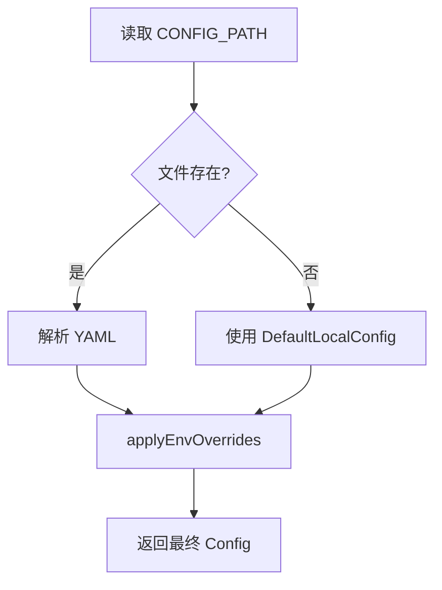

# 02 - 仓库与配置基线

## 1. 目标

Phase 0 解决三个问题：

1. 项目从“父目录仓库的子目录”变成独立 Git 仓库。
2. 真实密码、JWT 密钥、运行数据不进入公开仓库。
3. 本地、Docker Compose、CI 使用同一套配置加载逻辑。

---

## 2. Git 仓库改造

改造前：

- `F:\zhuomian\文件夹\项目` 才是 Git 仓库根目录。
- remote 指向 `ai-job-search`。
- `feedsystem_video_go-main` 只是父仓库中的一个未跟踪目录。

改造后：

```bash
cd feedsystem_video_go-main
git init -b main
git remote add origin https://github.com/ccjh2543-rgb/SVideo.git
```

父仓库不受影响。

### 2.1 不进入仓库的内容

`.gitignore` 关键配置：

```gitignore
data/
.run/
backend/.run/
backend/.run/uploads/

.env
.env.*
!.env.example

backend/configs/config.yaml
backend/configs/config.compose-local.yaml
backend/configs/config.docker.yaml

面试问题/
项目解析/
项目解析.md

.trae/
```

说明：

- `data/` 是 RabbitMQ mnesia 运行数据，其中包含 `.erlang.cookie`。
- `.env` 包含数据库、Redis、RabbitMQ 密码和 JWT 密钥。
- 面试资料和项目解析只保留本地，不进入公开仓库。
- `config.example.yaml` 和 `.env.example` 是唯一提交的模板。

### 2.2 Docker 构建上下文

新增根目录 `.dockerignore`：

```dockerignore
.git
.github
.trae
data
.run
.env
.env.*
backend/configs/config.yaml
backend/configs/config.compose-local.yaml
backend/configs/config.docker.yaml
frontend/node_modules
frontend/dist
```

原因：Dockerfile 的构建上下文是项目根目录，`.gitignore` 不会影响镜像构建。如果不加 `.dockerignore`，真实配置可能被打进镜像。

---

## 3. 配置加载优先级

优先级从高到低：

```text
环境变量 > YAML 配置文件 > 代码内默认值
```

### 3.1 加载流程



### 3.2 环境变量映射

| YAML 字段 | 环境变量 |
|---|---|
| `server.port` | `SERVER_PORT` |
| `database.host` | `DB_HOST` |
| `database.port` | `DB_PORT` |
| `database.user` | `DB_USER` |
| `database.password` | `DB_PASSWORD` |
| `database.dbname` | `DB_NAME` |
| `redis.host` | `REDIS_HOST` |
| `redis.port` | `REDIS_PORT` |
| `redis.password` | `REDIS_PASSWORD` |
| `redis.db` | `REDIS_DB` |
| `rabbitmq.host` | `RABBITMQ_HOST` |
| `rabbitmq.port` | `RABBITMQ_PORT` |
| `rabbitmq.username` | `RABBITMQ_USERNAME` |
| `rabbitmq.password` | `RABBITMQ_PASSWORD` |
| `observability.pprof.enabled` | `PPROF_ENABLED` |
| `observability.pprof.api_addr` | `PPROF_API_ADDR` |
| `observability.pprof.worker_addr` | `PPROF_WORKER_ADDR` |

### 3.3 关键代码

```go
func Load(filename string) (Config, error) {
    data, err := os.ReadFile(filename)
    if err != nil {
        return Config{}, fmt.Errorf("failed to read config file: %w", err)
    }

    var cfg Config
    if err := yaml.Unmarshal(data, &cfg); err != nil {
        return Config{}, fmt.Errorf("parse config %s: %w", filename, err)
    }

    // 环境变量优先级高于配置文件
    applyEnvOverrides(&cfg)
    return cfg, nil
}
```

`applyEnvOverrides` 的约定：

- 环境变量为空时，不覆盖 YAML。
- 整型解析失败时，记录日志并保留原值。
- 所有字符串统一 `TrimSpace`。

```go
func overrideInt(target *int, key string) {
    v := getenv(key)
    if v == "" {
        return
    }
    n, err := strconv.Atoi(v)
    if err != nil {
        log.Printf("invalid %s %q: %v", key, v, err)
        return
    }
    *target = n
}
```

---

## 4. JWT 密钥

JWT 密钥不再有代码内默认值。

```go
func NewJWTServiceFromEnv() (*JWTService, error) {
    secret := os.Getenv("JWT_SECRET")
    if secret == "" {
        return nil, errors.New("JWT_SECRET is required")
    }
    return NewJWTService([]byte(secret), defaultAccessTTL, defaultRefreshTTL), nil
}
```

影响：

- 未设置 `JWT_SECRET` 时，API 启动直接失败。
- Docker Compose 使用 `${JWT_SECRET:?JWT_SECRET is required}`，缺少变量时 Compose 也会报错。
- 本地运行必须在 shell 中设置环境变量，或通过 IDE 启动配置注入。

PowerShell 示例：

```powershell
$env:JWT_SECRET="dev-secret-change-me"
$env:DB_PASSWORD="123456"
$env:CONFIG_PATH="configs/config.yaml"
go run ./cmd
```

---

## 5. Docker Compose

数据库、Redis、RabbitMQ 和后端都改为环境变量注入：

```yaml
backend:
  environment:
    CONFIG_PATH: /app/configs/config.yaml
    DB_HOST: mysql
    DB_PORT: "3306"
    DB_USER: root
    DB_PASSWORD: "${MYSQL_ROOT_PASSWORD:-123456}"
    DB_NAME: "${DB_NAME:-feedsystem}"
    REDIS_HOST: redis
    REDIS_PORT: "6379"
    REDIS_PASSWORD: "${REDIS_PASSWORD:-123456}"
    RABBITMQ_HOST: rabbitmq
    RABBITMQ_PORT: "5672"
    RABBITMQ_USERNAME: "${RABBITMQ_USERNAME:-admin}"
    RABBITMQ_PASSWORD: "${RABBITMQ_PASSWORD:-password123}"
    JWT_SECRET: "${JWT_SECRET:?JWT_SECRET is required}"
  volumes:
    - ./backend/configs/config.example.yaml:/app/configs/config.yaml:ro
```

首次启动：

```bash
cp .env.example .env
# 修改 .env 中的密码和 JWT_SECRET
docker compose up -d --build
```

---

## 6. 配置路径修正

改造前 `cmd/main.go` 默认路径是：

```go
configPath = "../configs/config.yaml"
```

从 `backend` 目录执行 `go run ./cmd` 时，这个路径会指到项目根目录下的 `configs`，文件不存在，最终回退到默认配置。

改造后统一为：

```go
configPath = "configs/config.yaml"
```

兼容：

- 本地：`cd backend && go run ./cmd`
- 容器：工作目录 `/app`，配置挂载到 `/app/configs/config.yaml`

Worker 也从 `../../configs/config.yaml` 改为 `configs/config.yaml`。

---

## 7. 边界情况

| 场景 | 行为 |
|---|---|
| 配置文件不存在 | 使用 `DefaultLocalConfig`，再应用环境变量 |
| YAML 解析失败 | 返回错误，启动失败 |
| 环境变量为空 | 保留 YAML 值 |
| 环境变量端口非法 | 记录日志，保留原值 |
| `JWT_SECRET` 未设置 | API 启动失败，避免不安全默认密钥 |
| Docker 构建 | `.dockerignore` 排除真实配置和运行数据 |
| 公开仓库 | `.gitignore` 排除 `.env`、真实配置、面试资料 |

已知限制：

- `config.example.yaml` 中的 `CHANGE_ME` 只是占位符，复制后必须修改。
- Docker Compose 中的 `${VAR:-default}` 仍然提供了开发默认密码，生产环境应通过 `.env` 覆盖。
- 配置加载没有热更新，修改配置需要重启进程。
