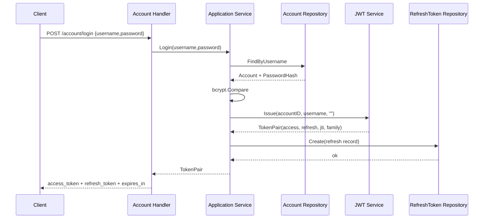
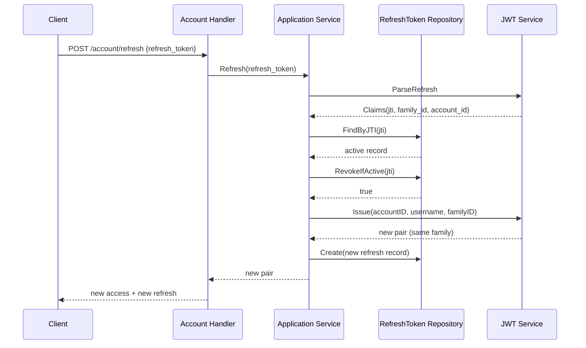

# 03 - 双 Token 认证链路

## 1. 设计目标

改造前只有一个 24 小时 Token：

- 有效期太长，泄露后风险大。
- 无法区分“访问令牌”和“刷新令牌”。
- 没有刷新轮换和重放检测。
- 登出、改密只能删除数据库里的当前 Token。

改造后：

| Token | 有效期 | 存放位置 | 用途 |
|---|---|---|---|
| Access Token | 15 分钟 | 客户端内存/localStorage | 调用业务接口 |
| Refresh Token | 7 天 | 客户端 localStorage + 服务端 MySQL | 换取新的 Access Token |

核心原则：

1. Access Token 短期有效，减少泄露窗口。
2. Refresh Token 长期有效，但每次刷新都轮换。
3. 旧 Refresh Token 再次出现，视为重放攻击，撤销整个 Token Family。
4. 登出、改密、改名可以撤销服务端会话。

---

## 2. 数据结构

### 2.1 领域实体

```go
type Account struct {
    ID           uint
    Username     string
    PasswordHash string
}
```

账号实体不保存 Token，避免把认证状态写进账号聚合。

### 2.2 Token 声明

```go
type Claims struct {
    AccountID uint
    Username  string
    TokenType TokenType
    JTI       string
    FamilyID  string
    ExpiresAt time.Time
}
```

JWT 中的实际 JSON：

```json
{
  "account_id": 42,
  "username": "alice",
  "token_type": "access",
  "family_id": "f0c1...",
  "iss": "svideo",
  "jti": "9a7c...",
  "iat": 1760000000,
  "nbf": 1760000000,
  "exp": 1760000900
}
```

字段含义：

| 字段 | 作用 |
|---|---|
| `account_id` | 当前用户 ID |
| `username` | 当前用户名，避免每次请求查库 |
| `token_type` | `access` 或 `refresh`，防止混用 |
| `family_id` | 一次登录会话的标识，轮换时保持不变 |
| `jti` | 单个 Token 的唯一 ID，用于撤销和重放检测 |
| `iss` | 签发者 |
| `exp` | 过期时间 |

### 2.3 TokenPair

```go
type TokenPair struct {
    AccessToken      string
    RefreshToken     string
    AccessExpiresAt  time.Time
    RefreshExpiresAt time.Time
    RefreshJTI       string
    FamilyID         string
}
```

`RefreshJTI` 和 `FamilyID` 不返回给前端，只用于服务端持久化。

### 2.4 刷新令牌记录

```go
type RefreshToken struct {
    ID        uint
    AccountID uint
    JTI       string
    FamilyID  string
    ExpiresAt time.Time
    RevokedAt *time.Time
    CreatedAt time.Time
}
```

---

## 3. 登录链路



关键代码：

```go
func (s *Service) Login(ctx context.Context, username, password string) (*domainaccount.TokenPair, error) {
    account, err := s.accounts.FindByUsername(ctx, normalized)
    if err != nil {
        return nil, domainaccount.ErrInvalidCredentials
    }
    if err := s.hasher.Compare(account.PasswordHash, password); err != nil {
        return nil, domainaccount.ErrInvalidCredentials
    }

    pair, err := s.tokens.Issue(account.ID, account.Username, "")
    if err != nil {
        return nil, err
    }
    if err := s.saveRefreshToken(ctx, account.ID, pair); err != nil {
        return nil, err
    }
    return pair, nil
}
```

登录响应：

```json
{
  "token": "<access_token>",
  "access_token": "<access_token>",
  "refresh_token": "<refresh_token>",
  "token_type": "Bearer",
  "expires_in": 900,
  "refresh_expires_in": 604800
}
```

`token` 字段保留给旧前端和压测脚本使用。

---

## 4. 刷新链路与轮换

### 4.1 正常刷新



关键代码：

```go
func (s *Service) Refresh(ctx context.Context, refreshToken string) (*domainaccount.TokenPair, error) {
    claims, err := s.tokens.ParseRefresh(refreshToken)
    if err != nil {
        return nil, domainaccount.ErrTokenInvalid
    }

    record, err := s.refreshTokens.FindByJTI(ctx, claims.JTI)
    if err != nil {
        return nil, domainaccount.ErrTokenInvalid
    }
    if record.AccountID != claims.AccountID || record.FamilyID != claims.FamilyID {
        return nil, domainaccount.ErrTokenInvalid
    }
    if record.RevokedAt != nil {
        _ = s.refreshTokens.RevokeFamily(ctx, record.FamilyID)
        return nil, domainaccount.ErrTokenRevoked
    }
    if s.now().After(record.ExpiresAt) {
        return nil, domainaccount.ErrTokenInvalid
    }

    rotated, err := s.refreshTokens.RevokeIfActive(ctx, claims.JTI)
    if err != nil {
        return nil, err
    }
    if !rotated {
        _ = s.refreshTokens.RevokeFamily(ctx, record.FamilyID)
        return nil, domainaccount.ErrTokenRevoked
    }

    account, err := s.accounts.FindByID(ctx, record.AccountID)
    if err != nil {
        return nil, domainaccount.ErrTokenInvalid
    }

    pair, err := s.tokens.Issue(account.ID, account.Username, record.FamilyID)
    if err != nil {
        return nil, err
    }
    if err := s.saveRefreshToken(ctx, account.ID, pair); err != nil {
        return nil, err
    }
    return pair, nil
}
```

### 4.2 为什么需要 `RevokeIfActive`

并发场景：

```text
两个请求同时拿同一个 Refresh Token 刷新
        │
        ├── 请求 A 查到 revoked_at = null
        └── 请求 B 查到 revoked_at = null
```

如果先查再更新，两个请求都可能成功，产生两个新 Refresh Token。

`RevokeIfActive` 使用条件更新：

```sql
UPDATE refresh_tokens
SET revoked_at = NOW()
WHERE jti = ? AND revoked_at IS NULL;
```

数据库保证只有一个请求 `RowsAffected = 1`。另一个请求得到 `false`，被判定为重放。

```go
func (r *RefreshTokenRepository) RevokeIfActive(ctx context.Context, jti string) (bool, error) {
    result := r.db.WithContext(ctx).
        Model(&RefreshTokenModel{}).
        Where("jti = ? AND revoked_at IS NULL", jti).
        Update("revoked_at", time.Now())
    if result.Error != nil {
        return false, result.Error
    }
    return result.RowsAffected > 0, nil
}
```

### 4.3 重放检测

场景：

1. 攻击者窃取了旧 Refresh Token。
2. 用户先正常刷新，旧 Token 被标记撤销。
3. 攻击者再使用旧 Token。

服务端行为：

```text
FindByJTI -> record.RevokedAt != nil
-> RevokeFamily(record.FamilyID)
-> 返回 401 token has been revoked
```

结果是该登录会话下的所有 Refresh Token 全部失效，用户需要重新登录。

### 4.4 Token Family

一次登录产生一个 `family_id`，后续每次刷新都沿用同一个 `family_id`。

```text
登录: family=A, refresh=jti1
刷新: family=A, refresh=jti2，jti1 撤销
刷新: family=A, refresh=jti3，jti2 撤销
重放 jti1 -> 撤销 family=A 下所有 Token
```

---

## 5. 登出、改密、改名

### 5.1 登出

```go
func (s *Service) Logout(ctx context.Context, accountID uint, refreshToken string) error {
    claims, err := s.tokens.ParseRefresh(refreshToken)
    if err != nil {
        // 登出幂等：Refresh Token 无效时也返回成功
        return nil
    }
    if claims.AccountID != accountID {
        return domainaccount.ErrPermissionDenied
    }
    return s.refreshTokens.RevokeFamily(ctx, claims.FamilyID)
}
```

撤销整个 Family，而不是单个 JTI。原因是客户端在刷新后可能持有新 Token，但 family 不变。

### 5.2 改密

```go
func (s *Service) ChangePassword(ctx context.Context, accountID uint, oldPassword, newPassword string) error {
    account, err := s.accounts.FindByID(ctx, accountID)
    if err != nil {
        return err
    }
    if err := s.hasher.Compare(account.PasswordHash, oldPassword); err != nil {
        return domainaccount.ErrInvalidCredentials
    }

    passwordHash, err := s.hasher.Hash(newPassword)
    if err != nil {
        return err
    }
    if err := s.accounts.UpdatePassword(ctx, accountID, passwordHash); err != nil {
        return err
    }
    return s.refreshTokens.RevokeAllByAccount(ctx, accountID)
}
```

改密后撤销该账号全部 Refresh Token，其他设备需要重新登录。

### 5.3 改名

```go
func (s *Service) Rename(ctx context.Context, accountID uint, newUsername string) (*domainaccount.TokenPair, error) {
    account, err := s.accounts.FindByID(ctx, accountID)
    if err != nil {
        return nil, err
    }
    if err := account.Rename(newUsername); err != nil {
        return nil, err
    }
    if err := s.accounts.UpdateUsername(ctx, accountID, account.Username); err != nil {
        return nil, err
    }
    if err := s.refreshTokens.RevokeAllByAccount(ctx, accountID); err != nil {
        return nil, err
    }

    pair, err := s.tokens.Issue(account.ID, account.Username, "")
    if err != nil {
        return nil, err
    }
    if err := s.saveRefreshToken(ctx, account.ID, pair); err != nil {
        return nil, err
    }
    return pair, nil
}
```

改名后旧 Token 中的 `username` 已经过时，因此撤销旧会话并签发新 Token。

---

## 6. JWT 签发与解析

### 6.1 签发

```go
func (s *JWTService) Issue(accountID uint, username string, familyID string) (*domainaccount.TokenPair, error) {
    now := s.now()
    if familyID == "" {
        familyID = newRandomID()
    }

    accessJTI := newRandomID()
    refreshJTI := newRandomID()
    accessExpiresAt := now.Add(s.accessTTL)
    refreshExpiresAt := now.Add(s.refreshTTL)

    accessToken, err := s.sign(tokenClaims{
        AccountID: accountID,
        Username:  username,
        TokenType: domainaccount.TokenTypeAccess,
        FamilyID:  familyID,
        RegisteredClaims: jwt.RegisteredClaims{
            Issuer:    issuer,
            ID:        accessJTI,
            IssuedAt:  jwt.NewNumericDate(now),
            NotBefore: jwt.NewNumericDate(now),
            ExpiresAt: jwt.NewNumericDate(accessExpiresAt),
        },
    })
    // refresh 同理
}
```

### 6.2 解析

```go
func (s *JWTService) parse(tokenString string, expected domainaccount.TokenType) (*domainaccount.Claims, error) {
    claims := &tokenClaims{}
    token, err := jwt.ParseWithClaims(
        tokenString,
        claims,
        func(token *jwt.Token) (interface{}, error) {
            if token.Method == nil || token.Method.Alg() != jwt.SigningMethodHS256.Alg() {
                return nil, errors.New("unexpected signing method")
            }
            return s.secret, nil
        },
        jwt.WithValidMethods([]string{jwt.SigningMethodHS256.Alg()}),
    )
    if err != nil || !token.Valid {
        return nil, domainaccount.ErrTokenInvalid
    }
    if claims.TokenType != expected {
        return nil, domainaccount.ErrTokenInvalid
    }
    if claims.ExpiresAt == nil || claims.AccountID == 0 || claims.ID == "" {
        return nil, domainaccount.ErrTokenInvalid
    }
    // 转换为领域 Claims
}
```

安全点：

- 只接受 HS256，防止算法混淆攻击。
- 校验 `token_type`，防止 Refresh Token 当 Access Token 使用。
- 校验 `account_id`、`jti`、`exp` 非空。
- 签名密钥只来自环境变量。

---

## 7. 接口示例

### 7.1 登录

```bash
curl -X POST http://localhost:8080/account/login \
  -H "Content-Type: application/json" \
  -d '{"username":"alice","password":"password"}'
```

### 7.2 刷新

```bash
curl -X POST http://localhost:8080/account/refresh \
  -H "Content-Type: application/json" \
  -d '{"refresh_token":"<refresh_token>"}'
```

### 7.3 调用受保护接口

```bash
curl -X POST http://localhost:8080/video/publish \
  -H "Authorization: Bearer <access_token>" \
  -H "Content-Type: application/json" \
  -d '{"title":"demo","play_url":"http://example.com/a.mp4","cover_url":"http://example.com/a.jpg"}'
```

### 7.4 登出

```bash
curl -X POST http://localhost:8080/account/logout \
  -H "Authorization: Bearer <access_token>" \
  -H "Content-Type: application/json" \
  -d '{"refresh_token":"<refresh_token>"}'
```

---

## 8. 边界情况

| 场景 | 行为 |
|---|---|
| 用户名不存在 | 返回 `invalid username or password`，不泄露账号是否存在 |
| 密码错误 | 同上 |
| Access Token 过期 | 业务接口返回 401，前端自动刷新 |
| Refresh Token 过期 | 刷新失败，用户重新登录 |
| 使用 Access Token 刷新 | `token_type` 不匹配，返回 401 |
| 使用 Refresh Token 调用业务接口 | `ParseAccess` 类型不匹配，返回 401 |
| 旧 Refresh Token 重放 | 撤销整个 Family，返回 401 |
| 并发刷新 | 条件更新保证只有一个成功，其余视为重放 |
| 登出时 Refresh Token 无效 | 幂等返回成功 |
| 登出时 Token 不属于当前账号 | 返回 403 |
| 改密后旧 Refresh Token | 全部撤销 |
| 改名后旧 Access Token | 15 分钟内仍可能有效，但前端已替换 Token |
| JWT_SECRET 未配置 | API 启动失败 |
| 签名算法被篡改 | 只接受 HS256，解析失败 |

### 8.1 Access Token 的撤销窗口

当前没有 Access Token 黑名单，因此：

- 登出后，Access Token 在剩余 15 分钟内理论上仍可使用。
- 改密后，旧 Access Token 也可能在 15 分钟内有效。

这是“短期 Access Token + 长期 Refresh Token”的常见权衡。

如果需要立即撤销 Access Token，可以增加：

```text
Redis key: auth:access:revoked:{jti}
TTL: Access Token 剩余有效期
```

每次 `JWTAuth` 解析后检查该 key。代价是每个请求多一次 Redis 查询。

### 8.2 时钟偏差

JWT 使用服务器时间校验 `exp`。多实例部署时应保证 NTP 同步，否则可能出现：

- 某台机器认为 Token 已过期。
- 某台机器认为 Token 还未生效。

当前没有额外 leeway 配置，生产环境可以通过 `jwt.WithLeeway` 增加容错。

### 8.3 密钥轮换

当前只支持一个 `JWT_SECRET`。

如果轮换密钥：

- 旧 Token 会立即全部失效。
- 用户需要重新登录。

生产环境通常使用 `kid` 支持多密钥平滑轮换，当前未实现。

### 8.4 Refresh Token 记录增长

每次登录和刷新都会插入一条 `refresh_tokens` 记录。

当前没有清理任务。建议增加：

```sql
DELETE FROM refresh_tokens
WHERE expires_at < NOW() - INTERVAL 7 DAY;
```

或者使用定时任务每天清理。
