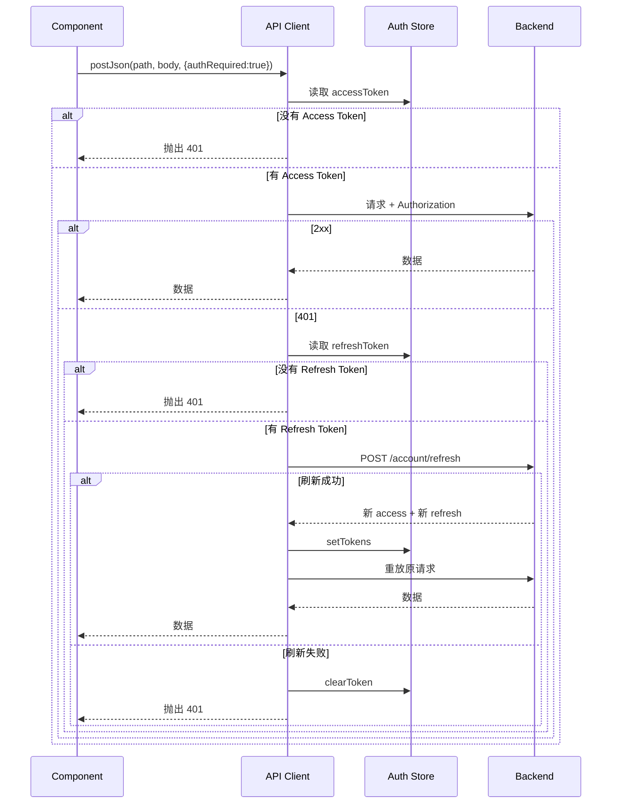

# 06 - 前端双 Token 与自动刷新

## 1. 改造前的问题

改造前前端只保存一个 `jwt_token`：

```ts
const TOKEN_KEY = 'jwt_token'

function setToken(newToken: string) {
  token.value = newToken
  localStorage.setItem(TOKEN_KEY, newToken)
}
```

问题：

- 没有 Refresh Token。
- Access Token 过期后只能重新登录。
- 无法处理并发 401。
- 后端改成双 Token 后，旧前端无法工作。

---

## 2. Token 存储

文件：`frontend/src/stores/auth.ts`

存储键：

| Key | 内容 |
|---|---|
| `access_token` | 当前 Access Token |
| `refresh_token` | 当前 Refresh Token |
| `jwt_token` | 旧版兼容键，写入 Access Token |

```ts
const ACCESS_KEY = 'access_token'
const REFRESH_KEY = 'refresh_token'
const LEGACY_KEY = 'jwt_token'
```

初始化：

```ts
const accessToken = ref<string | null>(readStorage(ACCESS_KEY) || readStorage(LEGACY_KEY))
const refreshToken = ref<string | null>(readStorage(REFRESH_KEY))
```

保存双 Token：

```ts
function setTokens(access: string, refresh?: string | null) {
  accessToken.value = access
  writeStorage(ACCESS_KEY, access)
  writeStorage(LEGACY_KEY, access)
  if (refresh) {
    refreshToken.value = refresh
    writeStorage(REFRESH_KEY, refresh)
  }
}
```

清理：

```ts
function clearToken() {
  accessToken.value = null
  refreshToken.value = null
  removeStorage(ACCESS_KEY)
  removeStorage(REFRESH_KEY)
  removeStorage(LEGACY_KEY)
}
```

保留 `setToken` 作为旧接口别名，避免其他页面报错。

---

## 3. 请求链路

文件：`frontend/src/api/client.ts`



---

## 4. 单飞刷新

多个请求同时 401 时，如果每个请求都去刷新：

```text
请求 A 401 -> 刷新 -> 新 refresh1
请求 B 401 -> 刷新 -> 新 refresh2
```

由于 Refresh Token 轮换，第二次刷新会使用旧 Token，可能触发重放检测。

前端用全局 Promise 合并刷新：

```ts
let refreshPromise: Promise<string | null> | null = null

async function refreshAccessToken(): Promise<string | null> {
  if (refreshPromise) return refreshPromise

  refreshPromise = (async () => {
    try {
      const res = await fetch(`${API_BASE}/account/refresh`, {
        method: 'POST',
        headers: { 'Content-Type': 'application/json' },
        body: JSON.stringify({ refresh_token: refreshToken }),
      })
      if (!res.ok) return null

      const data = (await res.json()) as TokenResponse
      const accessToken = data.access_token || data.token
      if (!accessToken || !data.refresh_token) return null

      auth.setTokens(accessToken, data.refresh_token)
      return accessToken
    } catch {
      return null
    } finally {
      refreshPromise = null
    }
  })()

  return refreshPromise
}
```

效果：

```text
A 401 ─┐
B 401 ─┼─> 共享同一个 refreshPromise -> 只发一次刷新请求
C 401 ─┘
```

---

## 5. 请求封装

```ts
async function request<T>(path: string, init: RequestInit, options?: RequestOptions): Promise<T> {
  const auth = useAuthStore()
  const token = auth.token

  if (options?.authRequired && !token) {
    throw new ApiError('需要先登录（缺少 token）', 401)
  }

  const headers = new Headers(init.headers)
  if (token) headers.set('Authorization', `Bearer ${token}`)

  let res = await fetch(`${API_BASE}${path}`, { ...init, headers })

  if (res.status === 401 && token && auth.refreshToken && !options?.skipRefresh) {
    const newAccessToken = await refreshAccessToken()
    if (newAccessToken) {
      headers.set('Authorization', `Bearer ${newAccessToken}`)
      res = await fetch(`${API_BASE}${path}`, { ...init, headers })
    }
  }

  // 解析响应、抛出 ApiError
}
```

请求选项：

| 选项 | 作用 |
|---|---|
| `authRequired` | 没有 Token 时直接抛 401 |
| `clearOn401` | 401 时是否清理本地会话 |
| `skipRefresh` | 是否禁止自动刷新 |

登录/注册使用 `skipRefresh: true`，避免错误密码触发刷新逻辑。

---

## 6. 页面适配

### 6.1 登录

```ts
const res = await accountApi.login(username, password)
auth.setTokens(res.access_token || res.token, res.refresh_token)
```

### 6.2 登出

```ts
await accountApi.logout(auth.refreshToken || '')
```

`logout` 不再设置 `skipRefresh`，因此：

- Access Token 过期时，前端会先刷新。
- 然后用新的 Access Token 调用登出。
- 服务端撤销整个 Family。

### 6.3 改名

改名会撤销旧 Token 并签发新 Token：

```ts
const res = await accountApi.rename(newUsername)
auth.setTokens(res.access_token || res.token, res.refresh_token)
```

### 6.4 改密

改密后服务端撤销全部 Refresh Token：

```ts
await accountApi.changePassword(oldPassword, newPassword)
auth.clearToken()
```

页面会跳回登录页，要求重新登录。

---

## 7. 边界情况

| 场景 | 行为 |
|---|---|
| Access Token 过期 | 自动刷新并重放原请求 |
| Refresh Token 过期 | 刷新失败，清理本地 Token，跳转登录 |
| 并发多个 401 | 共享一个刷新 Promise，只刷新一次 |
| 刷新请求本身 401 | `skipRefresh` 防止递归 |
| 登录密码错误 | `clearOn401: false`，不影响现有会话 |
| localStorage 不可用 | `try/catch` 返回 null，内存态仍可工作 |
| 旧 `jwt_token` 存在 | 作为 Access Token 兼容读取 |
| 刷新成功但原请求仍 401 | 第二次 401 后清理 Token |
| 登出时 Access Token 过期 | 先刷新再登出，确保撤销 Refresh Token |
| 改密时 Access Token 过期 | 先刷新再改密 |

### 7.1 为什么刷新请求不经过 `request`

`refreshAccessToken` 直接使用 `fetch`，原因：

- 避免 401 时再次触发刷新，形成递归。
- 避免循环依赖：`client.ts` 依赖 `auth` store，`auth` store 不应该反向依赖 `client`。
- 刷新请求不需要 Authorization 头，只需要 Refresh Token。

### 7.2 为什么保留 `jwt_token`

兼容：

- 旧页面可能直接读取 `jwt_token`。
- 压测脚本或调试工具可能依赖旧键。
- 迁移期不需要一次性修改所有页面。

新代码应优先使用 `access_token`。

---

## 8. 安全注意

1. `localStorage` 可以被 XSS 读取，生产环境建议使用 `HttpOnly Cookie` 保存 Refresh Token。
2. 当前实现适合课程项目和面试演示，不等同于生产级前端安全方案。
3. 不要在控制台打印完整 Token。
4. 登出后必须清理本地 Token，避免残留。
5. Refresh Token 轮换后，旧 Token 不应继续保存在任何地方。
