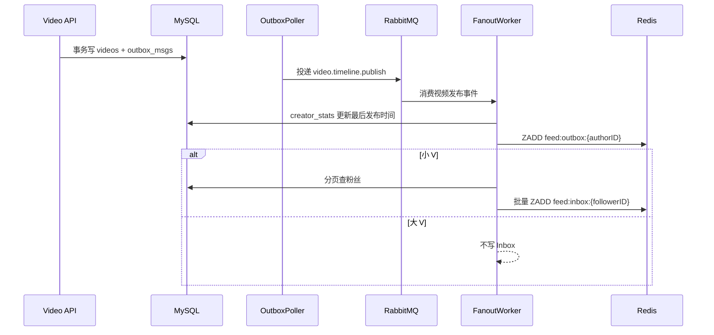

# 10 - 推拉结合 Feed

## 1. 目标

改造前关注流是纯拉模式：

```sql
SELECT * FROM videos
WHERE author_id IN (
    SELECT vlogger_id FROM socials WHERE follower_id = ?
)
AND create_time < ?
ORDER BY create_time DESC
LIMIT ?
```

问题：

- 关注很多作者时，每次都要实时查 MySQL。
- 无法针对大 V 做特殊处理。
- 发布视频后，关注流不会立刻出现。

改造后：

```text
小 V：发布时异步写粉丝 Inbox
大 V：只写自己的 Outbox，粉丝读时拉取
所有作者：都维护 Outbox，用于新关注回填和读己所写
```

---

## 2. 数据结构

### 2.1 创作者统计表

```go
type CreatorStatsModel struct {
    AuthorID        uint       `gorm:"primaryKey;autoIncrement:false"`
    FansCount       int64      `gorm:"not null;default:0"`
    IsBig           bool       `gorm:"not null;default:false"`
    LastPublishTime *time.Time `gorm:"index"`
}
```

表名：`creator_stats`。

字段作用：

| 字段 | 作用 |
|---|---|
| `author_id` | 作者 ID |
| `fans_count` | 粉丝数，关注/取关时增减 |
| `is_big` | 是否大 V，粉丝数 >= 阈值时置为 true |
| `last_publish_time` | 最后发布时间 |

大 V 阈值：

```go
const BigVFansThreshold int64 = 100000
```

### 2.2 Redis 时间线

```text
feed:inbox:{userID}       ZSET  member=videoID  score=发布时间毫秒
feed:outbox:{authorID}    ZSET  member=videoID  score=发布时间毫秒
```

裁剪策略：

| Key | 保留条数 |
|---|---:|
| Inbox | 500 |
| Outbox | 100 |

TTL：7 天。

为什么用 ZSET：

- `ZADD` 幂等，MQ 重试不会产生重复视频。
- 按 score 排序，天然支持时间倒序。
- 支持 `ZREVRANGEBYSCORE` 游标读取。

---

## 3. 发布链路



关键代码：

```go
func (s *FanoutService) Handle(ctx context.Context, videoID uint, authorID uint, createTime time.Time) error {
    if err := s.creators.UpsertOnPublish(ctx, authorID, createTime); err != nil {
        return err
    }

    score := createTime.UnixMilli()
    if err := s.timeline.PushOutbox(ctx, authorID, videoID, score); err != nil {
        return err
    }

    stats, err := s.creators.Get(ctx, authorID)
    if err != nil {
        return err
    }
    if stats.IsBig || stats.FansCount >= s.threshold {
        return nil
    }

    var afterFollowerID uint
    for {
        followerIDs, err := s.followers.ListFollowerIDsAfter(ctx, authorID, afterFollowerID, s.batchSize)
        if err != nil {
            return err
        }
        if len(followerIDs) == 0 {
            return nil
        }
        if err := s.timeline.PushInboxBatch(ctx, followerIDs, videoID, score); err != nil {
            return err
        }
        afterFollowerID = followerIDs[len(followerIDs)-1]
        if len(followerIDs) < s.batchSize {
            return nil
        }
    }
}
```

---

## 4. 读取链路

```text
ListByFollowing
-> 查 creator_stats + socials 得到关注作者和大 V 标记
-> 读自己的 Inbox
-> 批量读大 V Outbox
-> 读自己的 Outbox（读己所写）
-> 按 score 倒序去重合并
-> GetVideoByIDs 查详情
-> buildFeedVideos 补点赞状态
-> 返回 next_time 游标
```

关键代码：

```go
entries, err := f.timelineRepo.ReadInbox(ctx, viewerAccountID, cursorMs, limit)
if err != nil {
    return ListByFollowingResponse{}, err
}

if len(bigVAuthorIDs) > 0 {
    groups, err := f.timelineRepo.ReadOutboxes(ctx, bigVAuthorIDs, cursorMs, limit)
    if err != nil {
        return ListByFollowingResponse{}, err
    }
    for _, group := range groups {
        entries = append(entries, group...)
    }
}

ownEntries, err := f.timelineRepo.ReadOutbox(ctx, viewerAccountID, cursorMs, limit)
if err != nil {
    return ListByFollowingResponse{}, err
}
entries = append(entries, ownEntries...)

merged := mergeTimelineEntries(entries, limit)
```

合并规则：

1. 按 `videoID` 去重，保留更高 score。
2. 按 `score` 倒序。
3. score 相同按 `videoID` 倒序，保证稳定。
4. 截断到 `limit`。

降级：

```text
Redis 不可用 / 时间线为空
-> listByFollowingFromDB
-> 原 MySQL 子查询
```

---

## 5. 边界情况

| 场景 | 当前处理 |
|---|---|
| MQ 重复投递 | `ZADD` 幂等 |
| 大 V 粉丝过多 | 不写 Inbox，读时拉取 |
| 关注几百个大 V | 单次最多合并 100 个 |
| 新用户没有 Inbox | 第一页回源 MySQL |
| 自己发布视频 | 读自己的 Outbox，立即可见 |
| 取关 | 当前不做 Inbox 清理，旧视频可能残留到裁剪 |
| 新关注 | 当前未回填历史视频；大 V 直接读 Outbox |
| Inbox 无限增长 | 每次写入裁剪到 500 条 |
| Outbox 无限增长 | 每次写入裁剪到 100 条 |
| Redis 故障 | 降级 MySQL |
| 视频被删除 | `GetVideoByIDs` 按 ID 找不到时丢弃 |
| 同一毫秒发布 | 合并时按 videoID 倒序兜底 |

### 5.1 已知不足

1. **取关未清理 Inbox**：读路径没有按当前关注列表过滤，旧视频会保留到裁剪。
2. **新关注未回填**：关注一个作者后，看不到他最近的历史视频。
3. **Fan-out 失败无进度断点**：消息进入 DLQ 后需要人工重放。
4. **粉丝统计与关注关系不是同一事务**：极端情况下粉丝数可能短暂不一致。

这些都可以作为后续优化点。

---

## 6. 测试

`backend/internal/application/feed/fanout_service_test.go`

- 小 V：写 Outbox + 所有粉丝 Inbox。
- 大 V：只写 Outbox，不写 Inbox。
- 粉丝分页：batchSize=2 时能正确翻页。

`backend/internal/feed/service_test.go`

- 时间线合并去重。
- 同分按 videoID 倒序。
- limit 截断。
