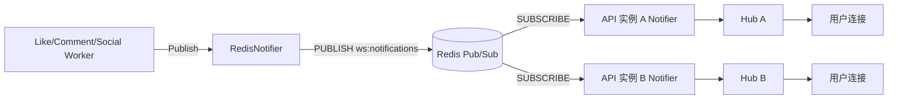

# 14 - WebSocket 即时通知

## 1. 目标

实现点赞、评论、关注事件的即时通知：

```text
用户 A 点赞用户 B 的视频
-> B 在线时收到 WebSocket 通知
```

要求：

- 未登录不能连接。
- 多实例部署时，连接和事件可能不在同一台机器。
- 断线自动重连。
- 连接、心跳、清理不能泄漏。

---

## 2. 总体架构



流程：

1. Worker 处理点赞/评论/关注成功后，发布通知事件到 Redis。
2. 每个 API 实例订阅 `ws:notifications`。
3. 收到事件后，根据 `account_id` 查找本机连接。
4. 通过 WebSocket 推送给对应用户。

---

## 3. 连接建立

客户端：

```text
ws://host/ws?token=<access_token>
wss://host/ws?token=<access_token>
```

Handler：

```go
func (h *Handler) Handle(c *gin.Context) {
    token := strings.TrimSpace(c.Query("token"))
    if token == "" {
        c.JSON(http.StatusUnauthorized, gin.H{"error": "missing token"})
        return
    }
    claims, err := h.tokens.ParseAccess(token)
    if err != nil {
        c.JSON(http.StatusUnauthorized, gin.H{"error": "invalid token"})
        return
    }

    conn, err := h.upgrader.Upgrade(c.Writer, c.Request, nil)
    if err != nil {
        return
    }
    newClient(h.hub, conn, claims.AccountID)
}
```

注意：

- 使用 Access Token，不用 Refresh Token。
- Token 放在 query 中，可能进入访问日志；生产环境建议改用 `Sec-WebSocket-Protocol` 或首帧认证。

---

## 4. Hub 结构

```go
type Hub struct {
    mu      sync.RWMutex
    clients map[uint]map[*Client]struct{}
}
```

- key 是 accountID。
- value 是该账号的全部连接。
- 同一账号允许多端同时在线。

注册：

```go
func (h *Hub) Register(client *Client) {
    h.mu.Lock()
    defer h.mu.Unlock()
    if h.clients[client.accountID] == nil {
        h.clients[client.accountID] = make(map[*Client]struct{})
    }
    h.clients[client.accountID][client] = struct{}{}
}
```

推送：

```go
func (h *Hub) SendToAccount(accountID uint, payload []byte) {
    h.mu.RLock()
    conns := make([]*Client, 0, len(h.clients[accountID]))
    for client := range h.clients[accountID] {
        conns = append(conns, client)
    }
    h.mu.RUnlock()

    for _, client := range conns {
        select {
        case client.send <- payload:
        default:
            h.Unregister(client)
        }
    }
}
```

设计点：

- 读锁只用于复制连接列表，发送时不持锁。
- 发送缓冲满时关闭连接，避免慢客户端拖垮其他用户。
- `Unregister` 会关闭 send channel，写协程收到关闭信号后退出。

---

## 5. 心跳与清理

参数：

```go
writeWait  = 10 * time.Second
pongWait   = 60 * time.Second
pingPeriod = 30 * time.Second
maxMessage = 4096
```

读协程：

```go
c.conn.SetReadLimit(maxMessage)
c.conn.SetReadDeadline(time.Now().Add(pongWait))
c.conn.SetPongHandler(func(string) error {
    return c.conn.SetReadDeadline(time.Now().Add(pongWait))
})
```

写协程：

```go
ticker := time.NewTicker(pingPeriod)
case <-ticker.C:
    _ = c.conn.SetWriteDeadline(time.Now().Add(writeWait))
    if err := c.conn.WriteMessage(websocket.PingMessage, nil); err != nil {
        return
    }
```

清理：

```go
defer func() {
    c.hub.Unregister(c)
    _ = c.conn.Close()
}()
```

---

## 6. 通知事件

```go
type Event struct {
    EventID   string         `json:"event_id"`
    AccountID uint           `json:"account_id"`
    Type      string         `json:"type"`
    Title     string         `json:"title"`
    Body      string         `json:"body"`
    Data      map[string]any `json:"data,omitempty"`
    CreatedAt time.Time      `json:"created_at"`
}
```

已接入：

| 事件 | 触发点 | 接收人 |
|---|---|---|
| `like` | 点赞 Worker | 视频作者 |
| `comment` | 评论 Worker | 视频作者 |
| `follow` | 关注 Worker | 被关注者 |

示例：

```json
{
  "event_id": "9a7c...",
  "account_id": 42,
  "type": "like",
  "title": "收到新的点赞",
  "body": "有人赞了你的视频",
  "data": {
    "video_id": 100,
    "from_account_id": 7
  }
}
```

---

## 7. Redis Pub/Sub

发布：

```go
func (n *RedisNotifier) Publish(ctx context.Context, event notification.Event) error {
    payload, err := json.Marshal(event)
    if err != nil {
        return err
    }
    return n.client.Publish(ctx, NotificationChannel, payload)
}
```

订阅：

```go
sub, err := n.client.Subscribe(ctx, NotificationChannel)
for {
    select {
    case <-ctx.Done():
        return ctx.Err()
    case message, ok := <-sub.Messages():
        if !ok {
            return nil
        }
        var event notification.Event
        json.Unmarshal(message.Payload, &event)
        n.hub.SendToAccount(event.AccountID, message.Payload)
    }
}
```

为什么用 Pub/Sub：

- API 多实例时，事件可能落在任意一台。
- 每个实例都订阅，只有持有目标连接的实例能推送成功。
- 不需要维护实例和连接的路由表。

限制：

- Redis Pub/Sub 不持久化，实例离线期间的消息会丢失。
- 如果需要可靠通知，应使用 Redis Stream 或消息队列。

---

## 8. 前端

Store：`frontend/src/stores/notifications.ts`

```ts
const protocol = window.location.protocol === 'https:' ? 'wss' : 'ws'
const url = `${protocol}://${window.location.host}/ws?token=${encodeURIComponent(token)}`
socket = new WebSocket(url)
```

重连：

```ts
socket.onclose = () => {
  connected.value = false
  socket = null
  if (!manualClose && auth.isLoggedIn && auth.token) {
    reconnectTimer = window.setTimeout(() => connect(auth.token ?? ''), 3000)
  }
}
```

去重：

```ts
if (item.event_id) {
  if (seen.has(item.event_id)) return
  seen.add(item.event_id)
}
```

展示：

```ts
toast.info(`${item.title}：${item.body}`)
```

`AppShell` 监听登录状态：

```ts
watch(
  () => [auth.isLoggedIn, auth.token] as const,
  ([loggedIn, token]) => {
    if (loggedIn && token) notifications.connect(token)
    else notifications.disconnect()
  },
  { immediate: true },
)
```

---

## 9. 代理配置

### 9.1 Vite

```ts
'/ws': {
  target: 'ws://127.0.0.1:8080',
  ws: true,
  changeOrigin: true,
},
```

### 9.2 Nginx

```nginx
location /ws {
    proxy_pass http://backend:8080/ws;
    proxy_http_version 1.1;
    proxy_set_header Upgrade $http_upgrade;
    proxy_set_header Connection "upgrade";
    proxy_set_header Host $http_host;
    proxy_read_timeout 3600s;
}
```

---

## 10. 边界情况

| 场景 | 行为 |
|---|---|
| 未携带 token | 401 |
| token 无效/过期 | 401 |
| 同一账号多端 | 每个连接都会收到 |
| 连接断开 | 前端 3 秒后重连 |
| 主动登出 | `manualClose=true`，不再重连 |
| 慢客户端 | send 缓冲满，关闭连接 |
| 多实例 | Redis Pub/Sub 广播 |
| Redis 故障 | 通知发布失败，不影响主业务 |
| 实例离线 | Pub/Sub 消息丢失 |
| 重复通知 | 前端按 event_id 去重 |
| Token 放 URL | 可能进入日志，生产需改造 |

### 10.1 已知不足

1. Redis Pub/Sub 不保证消息可靠送达。
2. 没有离线通知持久化。
3. 没有通知已读/未读状态。
4. Token 放在 query string，生产环境建议使用首帧认证。
5. 没有连接数、推送失败率监控。

---

## 11. 测试

`backend/internal/interfaces/ws/hub_test.go`

- 指定账号能收到消息。
- 其他账号不会收到。
- 注销后 send channel 关闭。
- 在线连接数正确归零。
