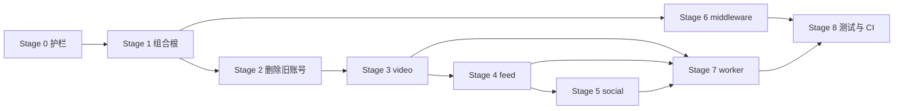

# 15 - 代码重构计划

## 执行进度

- [x] Stage 0：架构依赖测试、路由快照测试
- [x] Stage 1：组合根收敛到 `cmd/main.go`，Router 只注册路由
- [x] Stage 2：删除旧 `internal/account`、`internal/auth`
- [x] Stage 3：拆分 video 上下文
- [x] Stage 4：拆分 feed 上下文
- [x] Stage 5：拆分 social 上下文
- [x] Stage 6：整理 middleware / platform
- [x] Stage 7：Worker 归位
- [x] Stage 8：测试与 CI 收口（CI 已覆盖 vet/test/build；架构依赖测试与路由快照已接入；Docker Compose 集成测试依赖本地 Docker 环境，未纳入 CI）

已完成提交：

- `329a13c refactor: converge API composition root and remove legacy auth`
- `92bdaeb refactor: move middleware into interface and infrastructure layers`
- `c5c3c6f refactor(video): split video context into DDD layers`
- `5eabef0 test(video): cover publish and comment validation`
- `b0f8b48 refactor(feed): split feed context into DDD layers`
- `dadeca5 refactor(social): split social context and merge creator stats`
- `b32da44 refactor(workers): group consumers by bounded context`

> 注意：以上提交均在本地，推送时 GitHub 网络连接失败，需要在网络恢复后执行 `git push origin main`。

## 1. 背景

当前项目已经完成了 Phase 0-5 的功能改造，但代码组织处于“旧架构 + DDD 新架构并存”的过渡状态。

典型表现：

- `internal/account` 与 `domain/account` 两套账号实现。
- `internal/auth` 单 Token 代码仍存在，但新链路已经不用。
- `internal/video` 同时包含实体、Handler、Service、Repository、缓存。
- `internal/feed` 与 `domain/feed` 同名但职责不同。
- `internal/http/router.go` 同时承担组合根、路由注册、Worker 启动。
- `middleware` 目录混合了接口层和基础设施层。
- Worker 同时依赖旧业务包和新 DDD 包。

本计划的目标不是“重写”，而是**在不改变现有接口行为的前提下，逐步收敛到清晰的 DDD 分层**。

---

## 2. 重构原则

1. **行为不变**：API 路径、请求字段、响应字段保持兼容，只允许新增字段。
2. **小步提交**：每个阶段独立 PR，合并前 `go vet`、`go test`、`go build`、`npm run build` 必须通过。
3. **先删重复，再搬目录**：优先删除旧账号/旧鉴权这类重复实现，再做纯目录迁移。
4. **一次只迁一个上下文**：账号 → 视频 → Feed → 社交，不并行大改。
5. **组合根唯一**：所有对象的创建放在 `cmd/api` 和 `cmd/worker`，Router 只注册路由。
6. **接口优先**：跨上下文依赖通过接口，不直接依赖对方的 Repository 或实体。
7. **不做无收益搬迁**：纯目录移动只有在能消除歧义或依赖时才做。

---

## 3. 目标结构

```text
backend/
├── cmd/
│   ├── api/
│   │   └── main.go                 # API 组合根
│   └── worker/
│       └── main.go                 # Worker 组合根
└── internal/
    ├── domain/
    │   ├── account/                # 账号、Token、密码规则
    │   ├── video/                  # Video、Like、Comment
    │   ├── social/                 # 关注关系、创作者统计
    │   ├── feed/                   # 时间线、热榜、Feed 查询接口
    │   └── notification/           # 通知事件
    ├── application/
    │   ├── account/
    │   ├── video/
    │   ├── social/
    │   ├── feed/
    │   └── notification/
    ├── infrastructure/
    │   ├── persistence/mysql/
    │   │   ├── account/
    │   │   ├── video/
    │   │   ├── social/
    │   │   └── feed/
    │   ├── cache/redis/
    │   │   ├── video/
    │   │   ├── social/
    │   │   └── feed/
    │   ├── messaging/rabbitmq/
    │   │   ├── queues.go
    │   │   ├── video/
    │   │   ├── social/
    │   │   └── feed/
    │   ├── security/
    │   └── workers/
    │       ├── video/
    │       ├── social/
    │       └── feed/
    ├── interfaces/
    │   ├── http/
    │   │   ├── account/
    │   │   ├── video/
    │   │   ├── social/
    │   │   ├── feed/
    │   │   └── middleware/
    │   │       ├── jwt/
    │   │       ├── ratelimit/
    │   │       └── idempotency/
    │   └── ws/
    └── platform/
        ├── config/
        ├── db/
        └── observability/
```

说明：

- `domain/feed` 只有一个，不再和 `internal/feed` 并存。
- `creator` 并入 `social` 上下文，`creator_stats` 表名保持不变。
- `middleware/cache`、`redis`、`rabbitmq` 归入基础设施。
- `jwt`、`ratelimit`、`idempotency` 归入 HTTP 接口层。
- `config`、`db`、`observability` 可选迁入 `platform`，不强制。

---

## 4. 分阶段计划

### Stage 0：建立重构护栏

**目标**：在动代码前先保证行为可验证。

任务：

1. 记录当前路由清单和请求/响应字段。
2. 增加 API 冒烟测试：
   - 注册、登录、刷新、登出
   - 发布视频、拉取最新流
   - 点赞、评论、关注
   - 拉取关注流、热榜
3. 增加 CI 检查：
   - `go vet ./...`
   - `go test ./...`
   - `go build ./...`
   - `npm run build`
4. 增加架构检查脚本（可选）：
   - 检查 `domain` 是否导入 `infrastructure`、`interfaces`。
   - 检查是否还有代码导入旧包。

**验收**：

- 冒烟测试全部通过。
- CI 能在 PR 上运行。
- 形成一份“当前行为基线”。

**风险**：低。

---

### Stage 1：收敛组合根

**目标**：让 `router.go` 只负责路由注册。

当前问题：

```go
// internal/http/router.go
accountRepository := account.NewAccountRepository(db)
videoService := video.NewVideoService(...)
billboardService := ...
worker.StartOutboxPoller(...)
```

任务：

1. 在 `cmd/api/main.go` 中构造所有 Repository、Service、Handler、中间件。
2. 定义依赖结构：

```go
type Dependencies struct {
    AccountHandler *accounthttp.Handler
    VideoHandler   *videohttp.Handler
    LikeHandler    *videohttp.Handler
    CommentHandler *videohttp.Handler
    SocialHandler  *socialhttp.Handler
    FeedHandler    *feedhttp.Handler
    WSAuth         *ws.Handler
    Tokens         domainaccount.TokenService
    Cache          *rediscache.Client
}
```

3. `http.SetRouter(deps Dependencies)` 只做：

```go
r.POST("/account/login", deps.AccountHandler.Login)
r.POST("/video/publish", jwt.JWTAuth(deps.Tokens), deps.VideoHandler.Publish)
```

4. 把 `StartOutboxPoller`、`StartConsumer` 移到 `cmd/api/main.go` 或 worker 组合根。
5. 把限流参数集中到一个 `ratelimit.Config`，不再散落在 Router。

**验收**：

- `internal/http/router.go` 中不再出现 `New...Repository`、`New...Service`、`New...MQ`。
- 路由数量和行为与改造前一致。
- 冒烟测试通过。

**风险**：中。  
**缓解**：先保留旧构造函数，只移动调用位置；路由逐组迁移。

---

### Stage 2：删除旧账号与旧鉴权

**目标**：消除两套账号逻辑。

当前重复：

- `internal/account/entity.go`、`repo.go`、`service.go`、`handler.go`
- `internal/auth/jwt.go`
- `domain/account` + `application/account` + `infrastructure/persistence/mysql/account_*`

任务：

1. 删除 `internal/account`、`internal/auth`。
2. 视频/评论/社交改用新账号能力：
   - 评论发布需要用户名：直接用 `jwt.GetUsername(c)`，不再查库。
   - 社交需要判断账号是否存在：定义 `AccountExistence` 接口，由账号仓储实现。
   - 视频发布使用 `jwt.GetAccountID(c)` / `jwt.GetUsername(c)`。
3. `db.AutoMigrate` 改用 `infrastructure/persistence/mysql.AccountModel`。
4. 确认 `accounts.token` 字段不再被读写。
5. 删除旧 `MockAccountID` 相关残留。

**验收**：

- 全仓库没有 `internal/account`、`internal/auth` 的导入。
- 注册、登录、刷新、登出、改名、改密全部通过。
- 发布视频、评论、关注仍能正确取到当前用户。

**风险**：中高。  
**缓解**：先加兼容接口，再逐文件替换，最后删除旧包。

---

### Stage 3：拆分 video 上下文

**目标**：把 `internal/video` 拆成四层。

当前 `internal/video` 包含：

```text
video_entity.go
video_handler.go
video_service.go
video_repo.go
like_*
comment_*
popularity_cache.go
```

任务：

1. `domain/video`：
   - `Video`、`Like`、`Comment` 实体
   - `VideoRepository`、`LikeRepository`、`CommentRepository` 接口
   - 领域错误
2. `application/video`：
   - `PublishVideo`
   - `Like` / `Unlike`
   - `PublishComment` / `DeleteComment`
   - 定义 `Cache`、`MessagePublisher`、`Notifier` 接口
3. `infrastructure/persistence/mysql/video`：
   - GORM 模型
   - 仓储实现
4. `infrastructure/cache/redis/video`：
   - 热度缓存、详情缓存
5. `interfaces/http/video`：
   - Handler、DTO、响应组装
6. 删除 `internal/video`。

**验收**：

- `/video/*`、`/like/*`、`/comment/*` 行为不变。
- `domain/video` 不导入 GORM、Redis、Gin。
- 点赞/评论异步链路和降级链路测试通过。

**风险**：高。  
**缓解**：先搬实体和仓储，再搬 Service，最后搬 Handler；每步保留旧入口。

---

### Stage 4：拆分 feed 上下文

**目标**：消除 `internal/feed` 与 `domain/feed` 的重名和职责混合。

任务：

1. `domain/feed`：
   - `TimelineEntry`
   - `TimelineRepository`
   - `FollowerReader`
   - Feed 查询接口
2. `application/feed`：
   - `ListLatest`
   - `ListByPopularity`
   - `ListByFollowing`
   - `FanoutService`
   - 热榜窗口与权重计算
3. `infrastructure/persistence/mysql/feed`：
   - Feed 查询仓储
4. `infrastructure/cache/redis/feed`：
   - Inbox/Outbox 时间线仓储
   - 热榜快照
5. `interfaces/http/feed`：
   - Handler、DTO、路由
6. 删除 `internal/feed`。

**验收**：

- `/feed/listLatest`、`/feed/listByPopularity`、`/feed/listByFollowing` 响应字段不变。
- `next_time`、`next_id`、`as_of` 等游标字段保持兼容。
- 时间线合并、热榜权重测试通过。

**风险**：高。  
**缓解**：先做纯函数迁移（热榜窗口、合并逻辑），再做 Handler。

---

### Stage 5：拆分 social 上下文

**目标**：统一关注关系和创作者统计。

任务：

1. `domain/social`：
   - `Social` 关系实体
   - `SocialRepository`
   - `CreatorStats` 和统计仓储接口
2. `application/social`：
   - `Follow`、`Unfollow`
   - 粉丝数增减
3. `infrastructure/persistence/mysql/social`：
   - `socials`、`creator_stats` 仓储
4. `interfaces/http/social`：
   - Handler、DTO
5. 删除 `internal/social`。
6. 将 `domain/creator` 合并进 `domain/social`。

**验收**：

- `/social/*` 行为不变。
- Feed Fan-out 仍能读取粉丝分页和创作者统计。
- 关注/取关幂等测试通过。

**风险**：中。  
**缓解**：`creator_stats` 表名和字段保持不变，只移动代码。

---

### Stage 6：整理 middleware 与 platform

**目标**：让目录名称和分层一致。

任务：

1. 移动：
   - `middleware/jwt` → `interfaces/http/middleware/jwt`
   - `middleware/ratelimit` → `interfaces/http/middleware/ratelimit`
   - `middleware/idempotency` → `interfaces/http/middleware/idempotency`
   - `middleware/redis` → `infrastructure/cache/redis`
   - `middleware/rabbitmq` → `infrastructure/messaging/rabbitmq`
   - `middleware/cache` → `infrastructure/cache`
2. 可选：
   - `config` → `platform/config`
   - `db` → `platform/db`
   - `observability` → `platform/observability`
3. 统一队列常量：
   - `infrastructure/messaging/rabbitmq/queues.go`
   - 删除 Worker 中重复的队列名和拓扑声明。

**验收**：

- 所有 import 更新完成。
- 无重复队列常量。
- `go test ./...`、`go build ./...` 通过。

**风险**：低到中。  
**缓解**：纯机械迁移，单独 PR，不混业务改动。

---

### Stage 7：Worker 归位

**目标**：让 Worker 也遵循上下文边界。

当前 Worker：

```text
internal/worker/
  likeworker.go
  commentworker.go
  socialworker.go
  popularityworker.go
  fanoutworker.go
  outboxworker.go
```

任务：

1. 按上下文拆到：
   - `infrastructure/workers/video`
   - `infrastructure/workers/social`
   - `infrastructure/workers/feed`
2. 每个 Worker 只依赖本上下文的 application 接口。
3. `cmd/worker/main.go` 作为唯一组合根，负责：
   - 读取配置
   - 连接 MySQL/Redis/RabbitMQ
   - 构造 Repository/Service/Worker
   - 启动消费者
4. 统一 ACK/Nack 与幂等逻辑。

**验收**：

- Worker 启动后所有队列都有消费者。
- 失败消息进入 DLQ。
- 重复消息不会重复计数。

**风险**：中。  
**缓解**：先搬文件，不改处理逻辑；再统一幂等。

---

### Stage 8：测试与 CI 收口

**目标**：重构后行为可回归。

任务：

1. 增加 Docker Compose 集成测试：
   - MySQL + Redis + RabbitMQ
   - 注册 → 登录 → 发布 → 拉取 Feed
   - 点赞 → MQ → 计数 → 通知
2. 增加路由冒烟测试，覆盖所有公开接口。
3. 增加架构检查：
   - `domain` 不导入 `application/infrastructure/interfaces`
   - `application` 不导入 `infrastructure/interfaces`
4. 更新 README 和接口文档。
5. 删除死代码、旧注释、旧队列名。

**验收**：

- CI 全绿。
- 集成测试可重复运行。
- 架构检查通过。

---

## 5. 阶段依赖关系



建议顺序：

1. Stage 0 + Stage 1
2. Stage 2
3. Stage 6（机械迁移，降低后续 import 成本）
4. Stage 3
5. Stage 4
6. Stage 5
7. Stage 7
8. Stage 8

---

## 6. 行为兼容清单

重构期间必须保持：

| 项目 | 要求 |
|---|---|
| API 路径 | 不变 |
| 登录响应 | 保留 `token`、`access_token`、`refresh_token` |
| 最新流响应 | 保留 `next_time`，新增 `next_id` |
| 热榜响应 | 保留 `as_of`、`next_offset` |
| 关注流响应 | 保留 `next_time` |
| 队列名 | 继续使用 v2 队列，不回到旧队列 |
| 数据库表 | `accounts`、`videos`、`likes`、`comments`、`socials`、`refresh_tokens`、`creator_stats`、`processed_events` 不变 |
| 前端 API | `frontend/src/api/types.ts` 字段保持兼容 |

---

## 7. 每个 PR 的 Definition of Done

- [ ] 只做一个阶段或一个子步骤
- [ ] 没有新增业务功能
- [ ] `go vet ./...` 通过
- [ ] `go test ./...` 通过
- [ ] `go build ./...` 通过
- [ ] `npm run build` 通过
- [ ] 路由冒烟测试通过
- [ ] 相关文档已更新
- [ ] 旧代码已删除，没有“暂时保留”的重复实现
- [ ] 没有新增跨层依赖

---

## 8. 风险与缓解

| 风险 | 影响 | 缓解 |
|---|---|---|
| 一次性搬迁过多 | 回归难定位 | 一次一个上下文 |
| 新旧包同时存在 | 依赖混乱 | 每个阶段结束删除旧包 |
| 路由行为变化 | 前端不可用 | 冒烟测试 + 字段兼容清单 |
| Worker 重复消费 | 计数错误 | 保持 `processed_events` 幂等 |
| 队列参数变更 | RabbitMQ 报错 | 继续使用 v2 队列 |
| 组合根移动遗漏 | 启动失败 | 先移动，再删旧构造函数 |
| 测试不足 | 重构无保护 | Stage 0 先补冒烟测试 |

---

## 9. 建议的第一批 PR

### PR 1：Stage 0

- 增加冒烟测试。
- 增加 CI 架构检查。
- 不改业务代码。

### PR 2：Stage 1

- 把组合根从 `router.go` 移到 `cmd/api/main.go`。
- Router 只接收 Handler。
- 不改路由行为。

### PR 3：Stage 2

- 删除 `internal/account`、`internal/auth`。
- 视频、评论、社交改用新账号能力。

完成这三个 PR 后，代码组织的最大混乱源会消失，再进入 video/feed/social 的逐模块迁移。

---

## 10. 最终验收标准

重构完成后应满足：

1. `internal` 下不再有 `account`、`auth`、`video`、`feed`、`social` 这些旧业务包。
2. `domain` 不依赖任何框架。
3. `application` 不依赖 MySQL、Redis、RabbitMQ、Gin。
4. `router.go` 不创建任何 Repository/Service。
5. Worker 只依赖本上下文的接口。
6. 所有 API 行为与重构前一致。
7. CI 包含单元测试、集成测试和架构检查。
