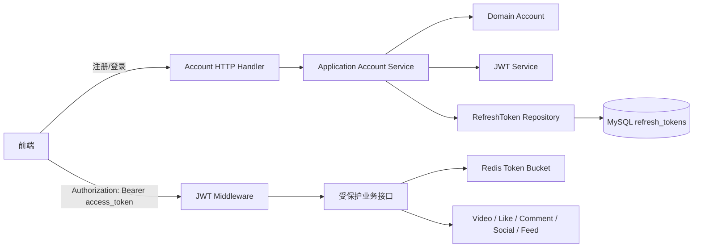

# SVideo 改造记录

本目录记录项目从“可运行的课程项目”向“可讲清原理、可支撑面试和后续扩展的工程”改造过程。

当前已完成的改造：

- 阶段 0：独立 Git 仓库、配置脱敏、DDD 分层骨架、CI 基线
- 阶段 1：DDD 账号模块、JWT 双 Token、JWT 鉴权接线、Redis Lua 令牌桶限流、前端自动刷新
- 阶段 2：推拉结合 Feed、小时级热榜、同毫秒游标兜底
- 阶段 3：逻辑过期缓存、随机 TTL、布隆过滤器、空值缓存
- 阶段 4：死信队列、消费端幂等、接口幂等键、Outbox 重试
- 阶段 5：WebSocket 通知、Redis Pub/Sub 多实例广播、前端自动重连

---

## 一、总体链路



核心设计原则：

1. **领域层不依赖框架**：`domain/account` 只包含实体、领域错误、仓储接口和 Token 接口。
2. **应用层编排用例**：登录、刷新、登出、改密、改名都放在 `application/account`。
3. **基础设施实现细节**：JWT、bcrypt、MySQL 仓储放在 `infrastructure`。
4. **接口层只做协议转换**：HTTP 参数绑定、错误映射、响应组装放在 `interfaces/http/account`。
5. **组合根统一装配**：`cmd/main.go` 创建仓储、JWT、应用服务，再注入路由。

---

## 二、文档索引

| 文档 | 内容 |
|---|---|
| [01-DDD架构改造.md](./01-DDD架构改造.md) | DDD 分层、依赖方向、组合根、渐进式迁移 |
| [02-仓库与配置基线.md](./02-仓库与配置基线.md) | Git 仓库、环境变量、配置脱敏、Docker Compose |
| [03-双Token认证链路.md](./03-双Token认证链路.md) | Access/Refresh Token、轮换、重放检测、Token Family |
| [04-JWT鉴权与路由改造.md](./04-JWT鉴权与路由改造.md) | JWTAuth、SoftJWTAuth、路由权限矩阵 |
| [05-令牌桶限流.md](./05-令牌桶限流.md) | Redis Lua 令牌桶、数据结构、限流维度、降级 |
| [06-前端双Token与自动刷新.md](./06-前端双Token与自动刷新.md) | Token 存储、401 刷新、并发刷新合并 |
| [07-数据库与数据结构.md](./07-数据库与数据结构.md) | accounts、refresh_tokens、索引、数据生命周期 |
| [08-测试与验证.md](./08-测试与验证.md) | 单元测试、构建验证、手工接口验证 |
| [09-边界情况与后续计划.md](./09-边界情况与后续计划.md) | 已知边界、遗留问题、后续改造路线 |
| [10-推拉结合Feed.md](./10-推拉结合Feed.md) | Inbox/Outbox、Fan-out、关注流合并、大 V 阈值 |
| [11-小时级热榜.md](./11-小时级热榜.md) | 小时桶、线性权重衰减、快照分页 |
| [12-缓存加固.md](./12-缓存加固.md) | 逻辑过期、TTL 抖动、布隆过滤器、空值缓存 |
| [13-MQ可靠性与幂等.md](./13-MQ可靠性与幂等.md) | DLQ、消费幂等、接口幂等键、Outbox 重试 |
| [14-WebSocket通知.md](./14-WebSocket通知.md) | WebSocket Hub、Redis Pub/Sub、通知事件、前端重连 |
| [15-代码重构计划.md](./15-代码重构计划.md) | 组合根、旧账号删除、video/feed/social 迁移顺序与验收标准 |

---

## 三、关键代码地图

```text
backend/
├── cmd/main.go                                      # 组合根
├── internal/
│   ├── domain/account/
│   │   ├── entity.go                                # Account 聚合根
│   │   ├── repository.go                            # 账号与刷新令牌仓储接口
│   │   └── token.go                                 # TokenService / PasswordHasher 接口
│   ├── application/account/
│   │   └── service.go                               # 注册、登录、刷新、登出、改密、改名
│   ├── infrastructure/
│   │   ├── persistence/mysql/
│   │   │   ├── account_model.go
│   │   │   ├── account_repository.go
│   │   │   ├── refresh_token_model.go
│   │   │   └── refresh_token_repository.go
│   │   └── security/
│   │       ├── jwt_service.go                       # HS256 双 Token
│   │       └── bcrypt_hasher.go
│   ├── interfaces/http/account/
│   │   ├── dto.go
│   │   └── handler.go
│   ├── middleware/jwt/jwt.go                        # JWTAuth / SoftJWTAuth
│   ├── middleware/ratelimit/token_bucket.go         # 令牌桶中间件
│   ├── middleware/redis/redis.go                    # Lua 令牌桶实现
│   ├── http/router.go                               # 路由与限流接线
│   └── config/loadconfig.go                         # 环境变量覆盖
└── frontend/src/
    ├── api/client.ts                                # 401 自动刷新
    ├── api/account.ts                               # 登录/刷新/登出/改密
    ├── stores/auth.ts                               # 双 Token 存储
    └── views/AccountView.vue                        # 登录页
```

---

## 四、改造前后对比

| 维度 | 改造前 | 改造后 |
|---|---|---|
| 账号代码 | `internal/account` 平铺 handler/service/repo | `domain/application/infrastructure/interfaces` 四层 |
| 鉴权 | 单 Token，24 小时，DB/Redis 存当前 Token | Access 15 分钟 + Refresh 7 天，轮换与重放检测 |
| 业务接口身份 | 大量使用 `MockAccountID` | 全部接入 `JWTAuth` / `SoftJWTAuth` |
| 限流 | 固定窗口计数器，且未挂载 | Redis Lua 令牌桶，挂到关键接口 |
| 配置 | YAML 中硬编码密码 | 环境变量优先，仓库只保留 example |
| 前端 | 只存一个 token | 双 Token + 401 自动刷新 + 并发刷新合并 |
| 测试 | 少量 Redis/pprof 测试 | 增加应用层、JWT、令牌桶测试 |

---

## 五、维护约定

1. 新增业务模块必须按 `domain → application → infrastructure → interfaces` 分层。
2. `domain` 禁止导入 GORM、Redis、Gin、RabbitMQ。
3. 新增跨层依赖时，优先在 `domain` 定义接口，由 `infrastructure` 实现。
4. 重要接口必须补充调用示例和边界情况说明。
5. 所有改造完成后更新本目录对应文档。
