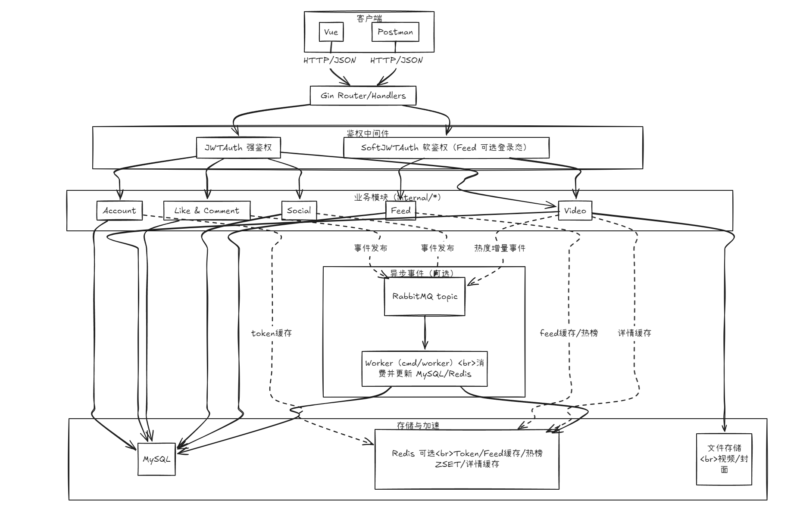
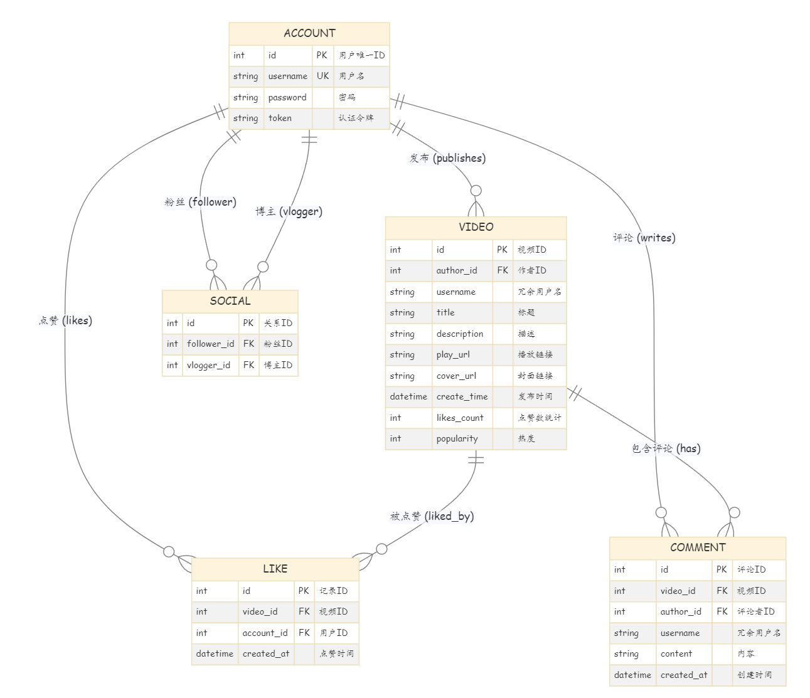
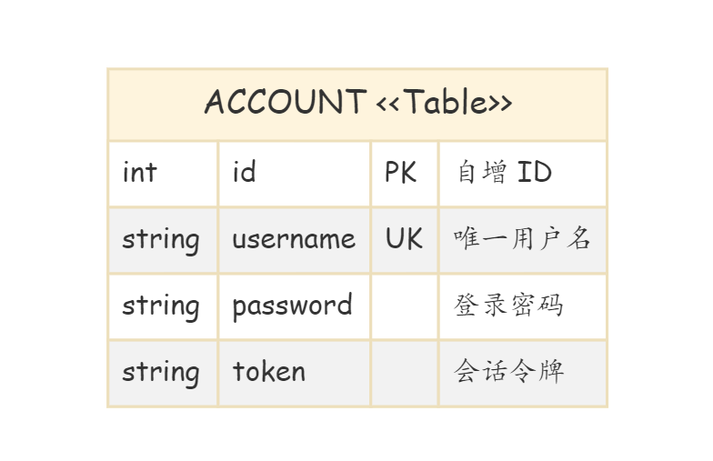
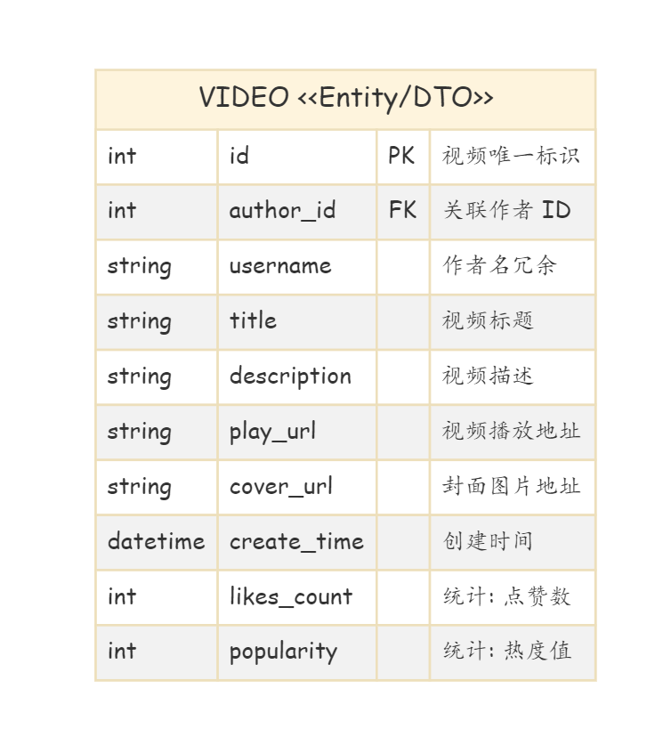
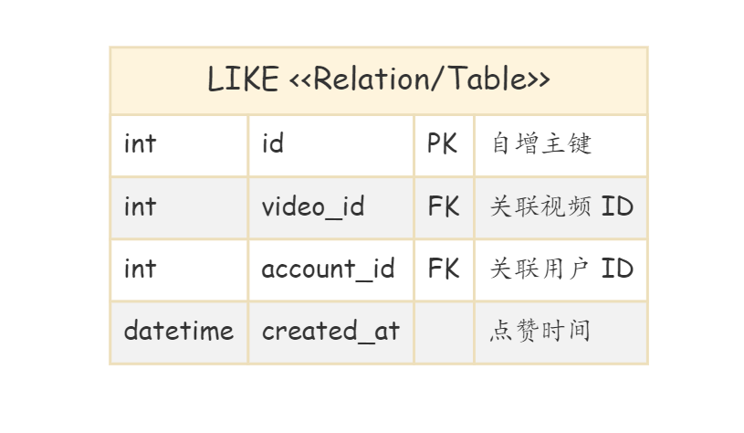
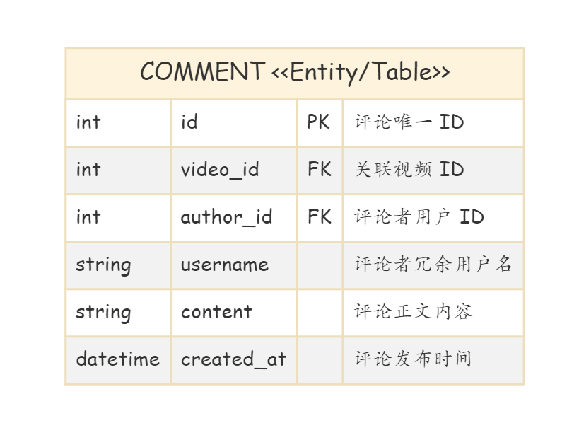
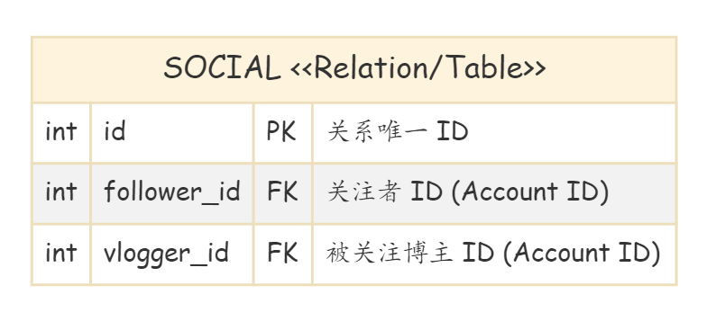
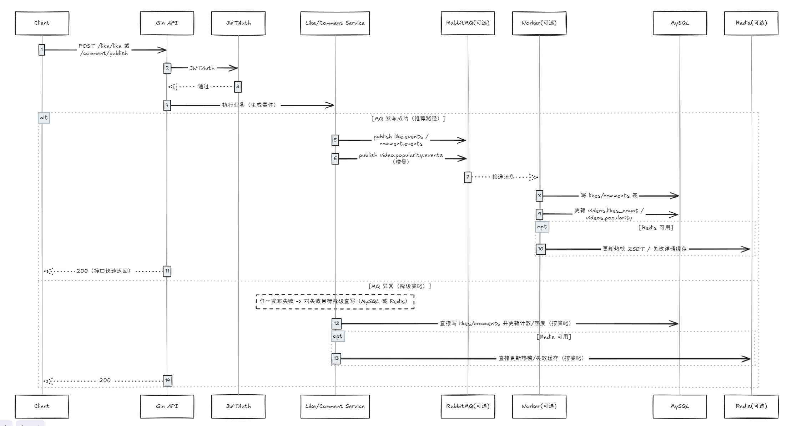
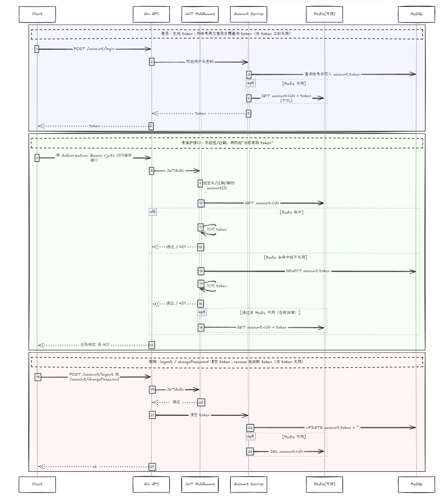

# 项目解析 - FeedSystem Video Go

## 一、项目概述

这是一个基于 Go + Vue 开发的短视频Feed流系统，实现了类似抖音的短视频推荐、社交互动功能。

### 技术栈
| 层级 | 技术 |
|------|------|
| **后端** | Go 1.22+ |
| **前端** | Vue 3 + TypeScript + Vite |
| **数据库** | MySQL + GORM |
| **缓存** | Redis |
| **消息队列** | RabbitMQ |
| **部署** | Docker + Docker Compose |

---

## 二、项目架构

### 整体架构图


### 系统设计亮点

1. **异步处理架构**
   - 点赞/评论操作通过 RabbitMQ 异步落库
   - 热度计算异步更新
   - 解决高并发下数据库写入压力问题

2. **多级缓存策略**
   - Redis 缓存热榜数据
   - 视频热度本地缓存 + Redis 二级缓存
   - 关注关系缓存

3. **Feed 流设计**
   - 基于时间线的分页游标方案
   - 软鉴权机制，支持未登录用户浏览
   - 热门视频推荐算法

---

## 三、后端架构 (Go)

### 目录结构
```
backend/
├── cmd/
│   ├── main.go          # 主服务入口
│   └── worker/          # 异步工作进程
├── internal/
│   ├── account/         # 用户账户模块
│   ├── auth/            # JWT认证
│   ├── config/          # 配置加载
│   ├── db/              # 数据库初始化
│   ├── feed/            # Feed流核心模块
│   ├── http/            # 路由定义
│   ├── middleware/      # 中间件
│   │   ├── jwt/
│   │   ├── rabbitmq/    # 消息队列
│   │   ├── ratelimit/   # 限流
│   │   └── redis/       # Redis缓存
│   ├── social/          # 社交关系模块
│   ├── video/           # 视频模块
│   │   ├── 点赞子模块
│   │   ├── 评论子模块
│   │   └── 热度缓存
│   ├── worker/          # 异步工作器
│   └── observability/   # 可观测性(pprof)
└── configs/
    └── 配置文件
```

### 核心模块详解

#### 1. Feed 流模块
| 文件 | 职责 |
|------|------|
| [entity.go](backend/internal/feed/entity.go) | Feed数据结构定义 |
| [handler.go](backend/internal/feed/handler.go) | HTTP接口处理 |
| [service.go](backend/internal/feed/service.go) | 业务逻辑：拉流、推荐 |
| [repo.go](backend/internal/feed/repo.go) | 数据持久层 |

**核心功能：**
- 首页Feed拉取（分页游标）
- 热门视频榜单
- 按用户关注拉取时间线

#### 2. 视频模块
| 子模块 | 功能 |
|--------|------|
| 视频基础 | 上传、发布、列表查询 |
| 点赞系统 | 异步点赞/取消，计数缓存 |
| 评论系统 | 多级评论，异步落库 |
| 热度计算 | 基于播放/点赞/评论的热度算法 |

#### 3. 账户模块
- 用户注册/登录
- JWT认证 + Token撤销
- 个人资料管理

#### 4. 社交模块
- 关注/取消关注
- 粉丝/关注列表
- 社交关系双向存储

---

## 四、前端架构 (Vue 3)

### 目录结构
```
frontend/
├── src/
│   ├── api/             # API接口层
│   ├── components/      # 公共组件
│   ├── router/          # 路由配置
│   ├── stores/          # Pinia状态管理
│   ├── utils/           # 工具函数
│   └── views/           # 页面组件
└── package.json
```

### 核心页面
| 页面 | 路径 | 功能 |
|------|------|------|
| FeedView | /feed | 视频Feed流，无限滚动 |
| VideoView | /video | 视频发布/播放 |
| HotView | /hot | 热门榜单 |
| UserProfile | /user | 用户主页 |
| AccountView | /account | 登录/注册 |

---

## 五、数据库设计

### ER表关系


### 核心数据表

| 表 | 关键字段 | 说明 |
|----|----------|------|
| **用户表** | id, username, password_hash | 用户信息 |
|  | | |
| **视频表** | id, author_id, title, play_count | 视频元数据 |
|  | | |
| **点赞表** | user_id, video_id, created_at | 点赞记录（联合唯一） |
|  | | |
| **评论表** | id, video_id, user_id, parent_id | 多级评论 |
|  | | |
| **关注表** | follower_id, followee_id | 双向关系 |
|  | | |

---

## 六、核心技术方案

### 1. 点赞/评论异步架构


**流程：**
1. 用户操作 → 立即更新Redis缓存
2. 发送消息到RabbitMQ
3. 返回成功响应给用户
4. Worker异步消费消息，写入MySQL
5. 降级方案：MQ故障时直接写库

### 2. 登录鉴权方案


- JWT无状态认证
- Redis黑名单实现Token撤销
- 中间件统一鉴权

### 3. Feed流实现


**技术点：**
- 游标分页 vs 偏移分页
- 软鉴权：登录/未登录不同Feed策略
- 热榜预计算缓存

---

## 七、部署架构

### Docker Compose 服务
```yaml
服务列表:
- MySQL        数据库
- Redis        缓存
- RabbitMQ     消息队列
- backend      Go API服务
- frontend     Vue前端
- worker       异步消费进程
```

### 配置文件
- `config.compose-local.yaml` 本地开发
- `config.docker.yaml` 容器环境
- `.vscode/launch.json` VS Code调试配置

---

## 八、启动方式

### 本地开发
```bash
# 1. 启动基础设施
docker-compose up -d mysql redis rabbitmq

# 2. 后端调试
# VS Code F5 启动调试

# 3. 前端启动
cd frontend && npm install && npm run dev
```

### 完整部署
```bash
docker-compose up -d
```

---

## 九、测试接口

Postman 测试集合: [test/postman.json](test/postman.json)

### 主要API
| 方法 | 路径 | 说明 |
|------|------|------|
| POST | /api/v1/account/register | 注册 |
| POST | /api/v1/account/login | 登录 |
| GET | /api/v1/feed | 获取Feed流 |
| POST | /api/v1/video/publish | 发布视频 |
| POST | /api/v1/video/like | 点赞 |
| POST | /api/v1/social/follow | 关注 |

---

## 十、项目亮点总结

✅ **高并发架构**：异步解耦 + 多级缓存  
✅ **完整社交体系**：关注 + 点赞 + 评论  
✅ **Feed流算法**：时间线 + 热门推荐  
✅ **前后端分离**：Go + Vue 3 现代栈  
✅ **工程化**：Docker一键部署 + IDE调试配置  
✅ **可观测**：pprof性能分析集成